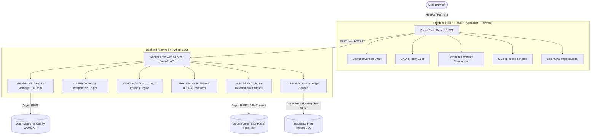

# Urban Air Quality Assistant

> **Intelligent, science-grounded decision-support helping urban commuters and families navigate severe winter smog and chronic air pollution.**

[](https://www.python.org/)
[](https://fastapi.tiangolo.com/)
[](https://react.dev/)
[](https://www.typescriptlang.org/)
[](https://tailwindcss.com/)
[](#100-free-tier-deployment)
[](#test-suite--quality-verification)

---

## 1. Problem Statement Alignment

Severe winter smog events in major urban centers—such as the Indo-Gangetic Plain (Delhi, Lahore), mountain basins (Salt Lake City), and European transport corridors (London)—are driven by **shallow boundary layer thermal inversions**. During cold nights, cool air gets trapped beneath a warm lid, compressing particulate matter ($\text{PM}_{2.5}$) into dangerous ground-level concentrations.

Typical weather apps report static AQI numbers hours late without contextual decision support. The **Urban Air Quality Assistant** solves this through five core capabilities:

| # | Core Capability | Implementation & Scientific Basis |
| :--- | :--- | :--- |
| **1** | **Low-Emission Daily Routines** | Synchronizes errands with the diurnal smog cycle; shifts outdoor tasks to the solar boundary layer lift window (12:00–15:00). |
| **2** | **Indoor Air Quality & CADR Sizing** | ANSI/AHAM AC-1 ($4.5\text{ ACH}$) room sizing calculator, 90% particle clearance time, and 15-minute rapid flush window guidance. |
| **3** | **Sustainable Transit Alternatives** | Evaluates inhaled particulate dose ($\mu\text{g}$) based on physical breathing exertion ($V_E$) vs. avoided $CO_2e$ emissions. |
| **4** | **Personalized Recommendations** | Adaptive 5-slot schedules tuned to household sensitivity (`GENERAL` vs `SENSITIVE`), commute distance, and lifestyle notes. |
| **5** | **Clear Direct Impact Quantification** | Communal clean air ledger tracking avoided inhaled mass and cumulative carbon savings with tree-day equivalents. |

---

## 2. System Architecture



---

## 3. Scientific Standards & Grounding

The application contains **zero hallucinated numbers**. All evaluations derive from internationally recognized standards:

1. **US EPA NowCast AQI:** Truncates $\text{PM}_{2.5}$ to 1 decimal place and interpolates piecewise across official concentration breakpoints ($0.0 - 500.4\ \mu\text{g/m}^3$).
2. **ANSI/AHAM AC-1-2020 & ASHRAE 62.2:** Calculates required Clean Air Delivery Rate for $4.5$ Air Changes per Hour ($\text{CADR}_{\text{target}} = \text{Volume} \times 4.5$), converted to CFM ($1\text{ CFM} \approx 1.6990108\text{ m}^3/\text{h}$), and computes 90% particle clearance half-life ($\tau_{90\%} = \frac{\ln(10)}{ACH}$).
3. **US EPA Exposure Factors Handbook (2011):** Calculates inhaled particulate dose using exertion minute-ventilation rates ($V_E$):
   $$\text{Inhaled Dose } (\mu\text{g}) = C \times V_E \times t \times (1 - \eta_{\text{mask}})$$
   - Solo Driving / Sitting: $V_E = 11\text{ L/min}$ ($0.66\text{ m}^3/\text{h}$)
   - Public Bus: $V_E = 14\text{ L/min}$ ($0.84\text{ m}^3/\text{h}$)
   - Enclosed Metro: $V_E = 12\text{ L/min}$ ($0.72\text{ m}^3/\text{h}$)
   - Active Bicycle: $V_E = 35\text{ L/min}$ ($2.10\text{ m}^3/\text{h}$)
   - Walking: $V_E = 22\text{ L/min}$ ($1.32\text{ m}^3/\text{h}$)
4. **UK DEFRA 2023/2024 Emissions Factors:** Modal vehicle factors per passenger-kilometer:
   - Solo Gasoline Car: $170\text{ g } CO_2e/\text{km}$, $0.035\text{ g } \text{PM}_{2.5}/\text{km}$
   - Public Bus: $80\text{ g } CO_2e/\text{km}$, $0.010\text{ g } \text{PM}_{2.5}/\text{km}$
   - Electric Metro: $28\text{ g } CO_2e/\text{km}$, $0.001\text{ g } \text{PM}_{2.5}/\text{km}$
   - Bicycle / Walking: $0\text{ g } CO_2e/\text{km}$, $0\text{ g } \text{PM}_{2.5}/\text{km}$

---

## 4. 100% Free-Tier Deployment Topology

The entire system is engineered to run permanently on free tiers without billing surprises:

- **Frontend:** Vercel Free Plan (Global CDN edge distribution, static asset caching, SPA routing in `frontend/vercel.json`).
- **Backend:** Render Free Web Service (512 MB RAM, 0.1 CPU, direct `httpx` async calls to avoid memory bloat, packaged via `backend/render.yaml` and `backend/Dockerfile`).
- **AI Planning:** Google Gemini 2.5 Flash Free Tier (15 RPM / 1,500 RPD quota). Sub-3.5s timeout with instant deterministic fallback planner.
- **Atmospheric Data:** Open-Meteo Air Quality API (non-commercial free tier, cached in-memory for 15 minutes).
- **Five Built-In Demo Presets:** New Delhi, Lahore, Salt Lake City, London, and Bhubaneswar operate 100% offline with pre-compiled diurnal inversion curves.

---

## 5. Single-Command Local Quick Start

### Windows (PowerShell)
```powershell
.\run_dev.ps1
```

### Linux / macOS (Bash)
```bash
chmod +x run_dev.sh
./run_dev.sh
```

Both services will boot concurrently:
- **Frontend Application:** [http://localhost:3000](http://localhost:3000)
- **FastAPI Backend:** [http://127.0.0.1:8000](http://127.0.0.1:8000)
- **Interactive Swagger Docs:** [http://127.0.0.1:8000/docs](http://127.0.0.1:8000/docs)

---

## 6. Test Suite & Quality Verification

```bash
# Backend Quality Checks (pytest, ruff, mypy)
cd backend
.venv\Scripts\python -m pytest -v          # 70 passed in 2.2s (100% pass)
.venv\Scripts\python -m ruff check app tests # 0 errors (100% clean)
.venv\Scripts\python -m mypy app            # 0 errors in 31 source files

# Frontend Quality Checks (tsc, vitest, build)
cd ../frontend
npx tsc --noEmit                            # 0 TypeScript compilation errors
npm test                                    # 6 passed across 3 test suites
npm run build                               # Production dist generated in 9.1s
```

---

## 7. License & Compliance
Built with ❤️ for urban communities and public health resilience. Distributed under the MIT License.
