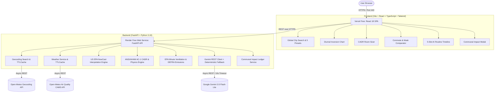

# Urban Air Quality Assistant

> **Intelligent, science-grounded decision-support helping urban commuters and families navigate severe winter smog and chronic air pollution.**

[](https://www.python.org/)
[](https://fastapi.tiangolo.com/)
[](https://react.dev/)
[](https://www.typescriptlang.org/)
[](https://tailwindcss.com/)
[](#5-100-free-tier-deployment)
[](#7-test-suite--quality-verification)

---

## 1. Problem Statement Alignment

Severe winter smog events in major urban centers—such as the Indo-Gangetic Plain (New Delhi, Lahore), mountain basins (Salt Lake City), European transport corridors (London), and rapidly growing cities (Bhubaneswar)—are driven by **shallow boundary layer thermal inversions**. During cold nights, cool air gets trapped beneath a warm inversion lid, compressing particulate matter ($\text{PM}_{2.5}$) into hazardous ground-level concentrations.

Typical weather apps report static AQI numbers without contextual decision support. The **Urban Air Quality Assistant** solves this through six core capabilities:

| # | Core Capability | Implementation & Scientific Basis |
| :--- | :--- | :--- |
| **1** | **Global City Search & Presets** | Search any city worldwide via Open-Meteo Geocoding (`GET /api/v1/locations/search`) or switch between 5 pre-configured presets with local solar-time forecasts. |
| **2** | **Low-Emission Daily Routines** | Synchronizes errands with the diurnal smog cycle; shifts outdoor tasks into the solar boundary layer lift window (12:00–15:00). |
| **3** | **Indoor Air Quality & CADR Sizing** | ANSI/AHAM AC-1 ($4.5\text{ ACH}$) room sizing calculator, 90% particle clearance time, and rapid window aeration flush guidance. |
| **4** | **Sustainable Transit Alternatives** | Evaluates inhaled particulate dose ($\mu\text{g}$) based on physical breathing exertion ($V_E$), mask efficiency (`NONE`, `SURGICAL`, `N95_FFP2`), and UK DEFRA $CO_2e$ emissions. |
| **5** | **AI + Deterministic Routine Planner** | Adaptive 5-slot schedules synthesized by Gemini (`gemini-3.5-flash-lite`) with safety guardrail overrides and an instant `<1 ms` deterministic fallback. |
| **6** | **Community Impact Ledger** | Tracks avoided inhaled $\text{PM}_{2.5}$ and cumulative $CO_2e$ savings with tree-day equivalents. |

---

## 2. System Architecture



---

## 3. Scientific Standards & Grounding

The application contains **zero hallucinated numbers**. All quantitative metrics derive from published standards in [constants.py](backend/app/domain/constants.py):

1. **US EPA NowCast AQI:** Truncates $\text{PM}_{2.5}$ to 1 decimal place and interpolates piecewise across official concentration breakpoints ($0.0 - 500.4\ \mu\text{g/m}^3$).
2. **ANSI/AHAM AC-1-2020 & ASHRAE 62.2:** Calculates required Clean Air Delivery Rate for $4.5$ Air Changes per Hour ($\text{CADR}_{\text{target}} = \text{Volume} \times 4.5$), converted to CFM ($1\text{ CFM} \approx 1.6990108\text{ m}^3/\text{h}$), and computes 90% particle clearance time ($\tau_{90\%} = \frac{\ln(10)}{\text{ACH}}$).
3. **US EPA Exposure Factors Handbook (2011):** Calculates inhaled particulate dose using exertion minute-ventilation rates ($V_E$):
   $$\text{Inhaled Dose } (\mu\text{g}) = C \times V_E \times t \times (1 - \eta_{\text{mask}})$$
   - Sedentary (Solo Car / Hybrid / EV / Bus / Metro): $V_E = 0.48\text{ m}^3/\text{h}$ ($\sim 8.0\text{ L/min}$)
   - Light Exertion (Walking): $V_E = 1.20\text{ m}^3/\text{h}$ ($\sim 20.0\text{ L/min}$)
   - Moderate Exertion (Bicycling): $V_E = 2.40\text{ m}^3/\text{h}$ ($\sim 40.0\text{ L/min}$)
   - Mask Filtration ($\eta_{\text{mask}}$): `NONE` ($0\%$), `SURGICAL` ($20\%$), `N95_FFP2` ($95\%$)
4. **UK DEFRA 2023/2024 Emissions Factors:** Modal tailpipe/upstream factors per passenger-kilometer:
   - Solo Gasoline Car: $170.0\text{ g } CO_2e/\text{km}$, $0.0150\text{ g } \text{PM}_{2.5}/\text{km}$
   - Hybrid Car: $105.0\text{ g } CO_2e/\text{km}$, $0.0070\text{ g } \text{PM}_{2.5}/\text{km}$
   - Electric Car (EV): $0.0\text{ g } CO_2e/\text{km}$ tailpipe, $0.0\text{ g } \text{PM}_{2.5}/\text{km}$
   - Diesel Bus: $82.0\text{ g } CO_2e/\text{km}$, $0.0035\text{ g } \text{PM}_{2.5}/\text{km}$
   - Electric Metro: $25.0\text{ g } CO_2e/\text{km}$ (grid upstream), $0.0\text{ g } \text{PM}_{2.5}/\text{km}$
   - Bicycle / Walking: $0.0\text{ g } CO_2e/\text{km}$, $0.0\text{ g } \text{PM}_{2.5}/\text{km}$

---

## 4. Local Setup & Environment Variables

### 1. Configure `.env` Files
```powershell
# Backend
Copy-Item backend\.env.example backend\.env

# Frontend
Copy-Item frontend\.env.example frontend\.env
```
- In `backend/.env`, optionally set `GEMINI_API_KEY=<your_key>` (`GEMINI_MODEL=gemini-3.5-flash-lite`, `GEMINI_TIMEOUT_SECONDS=10.0`). If omitted, the deterministic fallback planner runs automatically.
- In `frontend/.env`, keep `VITE_API_BASE_URL=/api` for local development (Vite proxies `/api` to `http://127.0.0.1:8000`).

### 2. Run Locally (Single Command)

**Windows (PowerShell):**
```powershell
.\run_dev.ps1
```

**Linux / macOS (Bash):**
```bash
chmod +x run_dev.sh
./run_dev.sh
```

- **Frontend UI:** [http://localhost:3000](http://localhost:3000)
- **FastAPI Backend:** [http://127.0.0.1:8000](http://127.0.0.1:8000)
- **Swagger API Docs:** [http://127.0.0.1:8000/docs](http://127.0.0.1:8000/docs)

---

## 5. 100% Free-Tier Deployment

- **Backend (Render Free Web Service):** Deploy directly via the root [render.yaml](render.yaml) Blueprint (`rootDir: backend`, `healthCheckPath: /api/health`) or [backend/Dockerfile](backend/Dockerfile). Add `GEMINI_API_KEY` in Render Environment Variables.
- **Frontend (Vercel Free):** Import the repository in Vercel with **Root Directory** set to `frontend` (uses [frontend/vercel.json](frontend/vercel.json)). Set `VITE_API_BASE_URL=https://<your-render-service>.onrender.com/api`.
- **Stateless Privacy-by-Design:** Runs with zero external database—atmospheric caches and the community impact ledger operate safely in memory (`TTLCache` + thread-safe `RLock`), storing no user PII or health data.

---

## 6. Project Structure

```text
urban-air-quality-assistant/
├── backend/
│   ├── app/
│   │   ├── api/v1/          # FastAPI controllers (locations, air_quality, calculators, assistant, impact)
│   │   ├── domain/          # Pure physics, EPA NowCast AQI, emissions, presets & safety rules
│   │   ├── schemas/         # Pydantic v2 DTOs
│   │   └── services/        # Open-Meteo weather client, Gemini AI service, fallback planner, impact ledger
│   ├── tests/               # Unit, integration & E2E pytest suites (71 tests)
│   ├── Dockerfile
│   ├── pyproject.toml
│   └── requirements.txt
├── frontend/
│   ├── src/
│   │   ├── api/             # Typed API client & DTO mirrors
│   │   ├── components/      # Dual-pane dashboard, Recharts diurnal chart, calculators & AI timeline
│   │   └── tests/           # Vitest + React Testing Library suites (9 tests)
│   └── vercel.json
├── render.yaml              # Render Blueprint (root)
├── run_dev.ps1              # Windows launcher
└── run_dev.sh               # Linux/macOS launcher
```

---

## 7. Test Suite & Quality Verification

```bash
# Backend Quality Checks
cd backend
.venv\Scripts\python -m pytest -v          # 71 passed (100% pass)
.venv\Scripts\python -m ruff check app tests # 0 errors
.venv\Scripts\python -m mypy app            # 0 errors across 31 source files

# Frontend Quality Checks
cd ../frontend
npx tsc --noEmit                            # 0 TypeScript errors
npm test                                    # 9 passed across 6 test files
npm run build                               # Production bundle built cleanly
```

---

## 8. License
Distributed under the MIT License.
